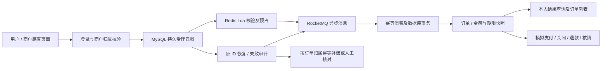

# Smart Life 项目展示与简历材料

定位：个人 Java 后端工程项目，现有业务为本地生活商户查询、固定价代金券购买、模拟支付、取消/退款与商户核销；包含名单批量发放待支付券订单。不是线上真实支付系统。

## 项目简介草稿

基于 Java 21、Spring Boot 3、MySQL、Redis、RocketMQ 和 Vue 3 实现本地生活优惠券系统，围绕异步订单受理、库存一致性、支付核销状态流转和批量发券完善可靠性链路，并提供真实依赖集成测试、故障恢复验证及可复跑测量材料。

## 可选简历条目

按版面选 4～5 条，并能根据对应源码说明选择和边界：

- **异步订单受理与恢复：** MySQL 持久保存受理意图，Redis Lua 原子校验活动、库存和领取资格，通过 RocketMQ 异步落单；按原订单 ID 查询与重发，发送结果不确定时保留预占，避免超时直接回滚造成晚到订单与库存冲突。
- **消费幂等与事务：** 按订单 ID 校验请求身份，结合用户锁、数据库用户/券唯一约束和同事务扣库存/插单，覆盖消息重投、并发消费及提交边界；确定拒绝持久化，Redis 补偿按订单归属幂等执行。
- **订单生命周期：** 在原个人页复用列表和详情弹窗完成模拟支付、取消、超时关闭、全额退款及商户核销；服务端保存金额/商户/期限快照，在事务中校验权限与状态，避免模板修改影响历史订单。
- **批量发券：** 使用 Apache POI SAX 处理 XLSX 名单，按 100 行暂存并在完整校验后发放；持久记录任务、原始行、稳定订单 ID、租约与失败原因，实现可解释进度及可恢复失败重试。文件限制 5 MiB/10000 行，公式、日期及精度风险 ID 拒绝。
- **查询与缓存优化：** 商户查询复用本地缓存、Redis、布隆过滤器与回源协调；订单列表用实际查询计划验证复合索引，列表商户授权按请求批量读取，在 20 张券夹具中权限查询由 20 次降为 1 次，实际核销仍校验最新权限。

性能数值只能引用本机报告标明的负载、环境、并发与业务结果，不把 SQL 次数减少写成吞吐提升倍数，不借用其他简历的 QPS。

## 演示顺序

1. 用合成用户登录，查看商户当前券与领取时间边界。
2. 领取后展示“受理处理中”到真实落单的变化，解释 HTTP 成功和订单成功的区别。
3. 在个人页展示本人订单、状态筛选、金额/期限快照；模拟支付后切换有权限的商户查看核销入口。
4. 在原商户区域导入含重复/无效用户的名单，查看逐行结果；只重试可恢复失败，不重新发放未知订单。
5. 展示[故障矩阵](validation/fault-matrix.md)、真实依赖测试与压测报告，解释人工核对和模拟资金边界。

## 面试问题与代码定位

| 问题 | 需要讲清楚的因果 | 入口 |
| --- | --- | --- |
| 为什么不能发送超时就加回库存？ | Broker 可能已收消息，只是响应丢失；保留预占，原 ID 重发靠消费幂等收敛 | [受理服务](../src/main/java/com/bee/smartlife/service/impl/VoucherOrderServiceImpl.java)、[恢复服务](../src/main/java/com/bee/smartlife/service/impl/OrderRecoveryService.java) |
| 为什么有 Redis 锁还要数据库约束？ | 锁协调执行，数据库约束守住最终业务唯一性；扣库存与插单须同事务 | [事务持久化](../src/main/java/com/bee/smartlife/service/impl/VoucherOrderPersistence.java)、[数据库结构](../src/main/resources/db/smart-life.sql) |
| 重复消费与重复领取如何区分？ | 同订单 ID 是传输重投，不同订单 ID 但同用户/券是领取规则冲突 | [消费业务](../src/main/java/com/bee/smartlife/service/impl/VoucherOrderServiceImpl.java) |
| 为什么取消后不能再领？ | 当前明确选择终身一人一券，返库存与释放领取资格是不同规则 | [库存返还](../src/main/java/com/bee/smartlife/service/impl/OrderStockReturn.java) |
| 为什么列表缓存不能决定核销权限？ | 列表仅展示，授权可能被撤销；实际操作必须检查当前权限 | [列表](../src/main/java/com/bee/smartlife/service/impl/OrderLifecycleService.java)、[操作事务](../src/main/java/com/bee/smartlife/service/impl/OrderLifecyclePersistence.java) |
| 怎么证明没有把处理中当成功？ | 保存原请求清单，核对受理终态、真实订单与失败/返还记录；pending/manual 单列 | 最终结果核对工具与原始报告 |
| 为什么不加微服务、分片和模板缓存？ | 尚无瓶颈证据；先用已测索引、回源协调和有界任务解决现有问题 | 查询计划、缓存测量、待办 |

## 已有证据入口

- [订单消费](validation/order-consumption.md)与[受理恢复](validation/order-recovery.md)：区分边界注入、消息等价重放与真实子 JVM 退出。
- [生命周期](validation/order-lifecycle.md)：真实页面、模拟付款/退款、授权、期限和状态竞争。
- [批量发券](validation/voucher-distribution.md)：名单、幂等、资源限制、实际内存与库存核对。
- [列表权限](validation/order-list-permissions.md)：20→1 查询次数、逐商户授权、撤权操作拒绝。
- [缓存功能负载](validation/cache-workload.md)：服务级调用与回源次数，明确不是 HTTP 容量压测。

本章新的并发、HTTP 压测与统一核对证据在实际完成后补入。这里不把已有测试数量永久写成最新总数；统一回归和最终提交 CI 以本轮验证记录为准。
