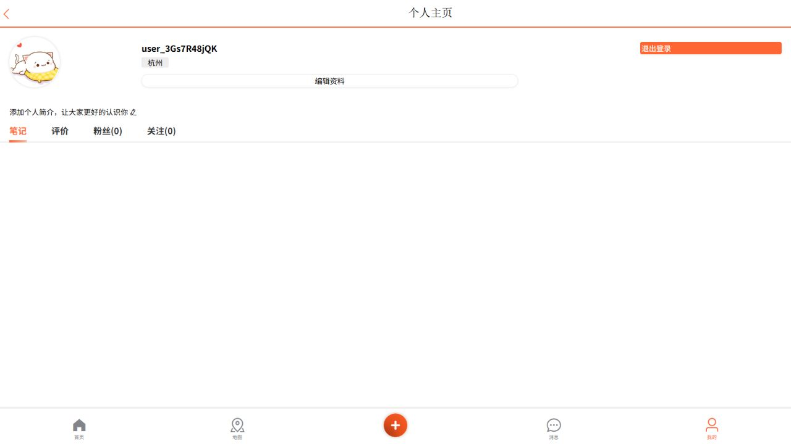
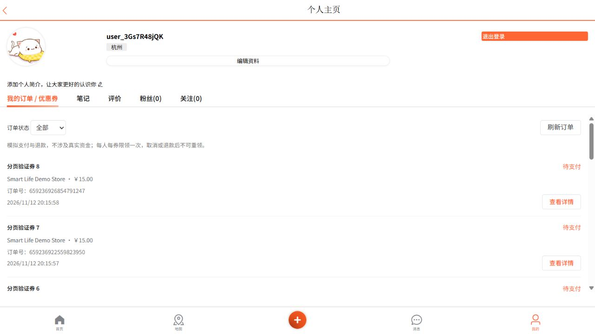
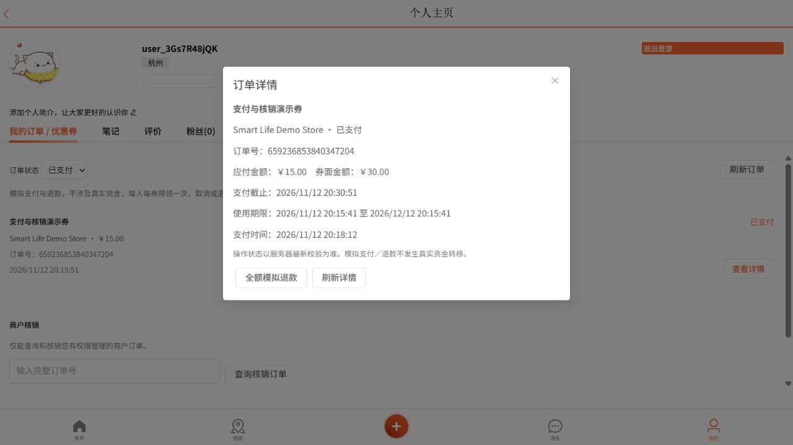
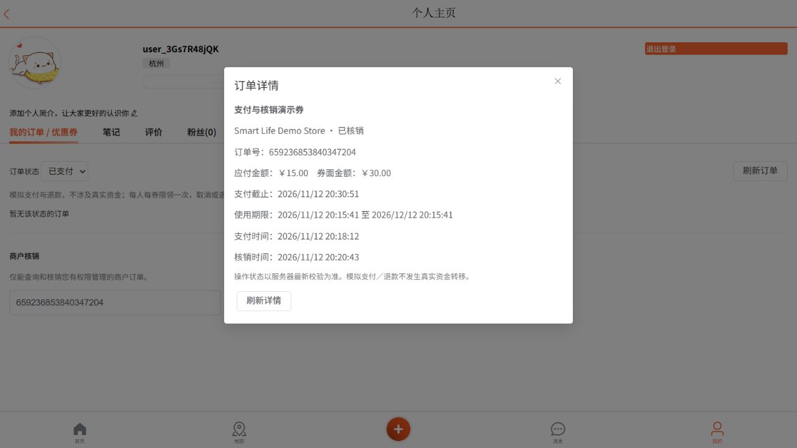
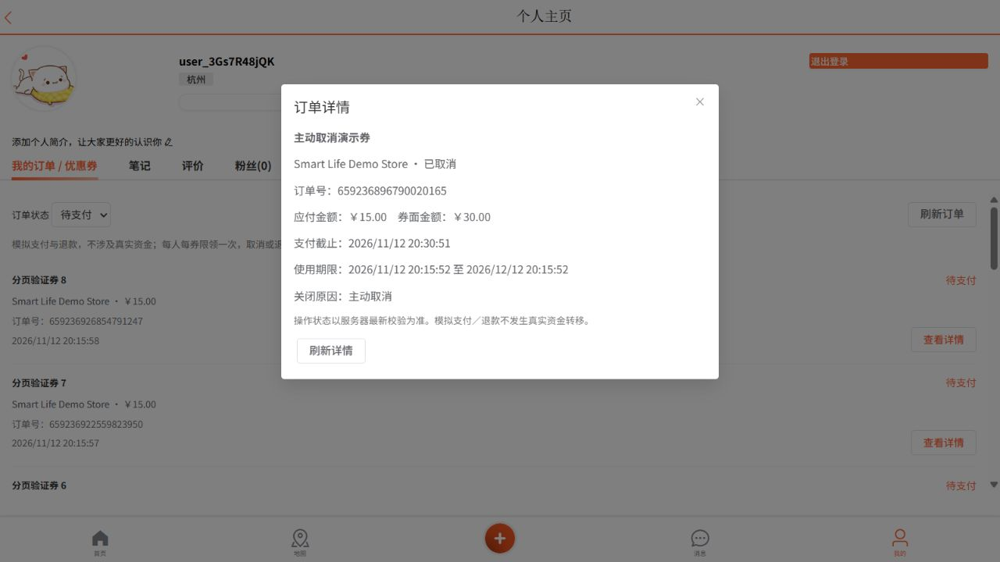
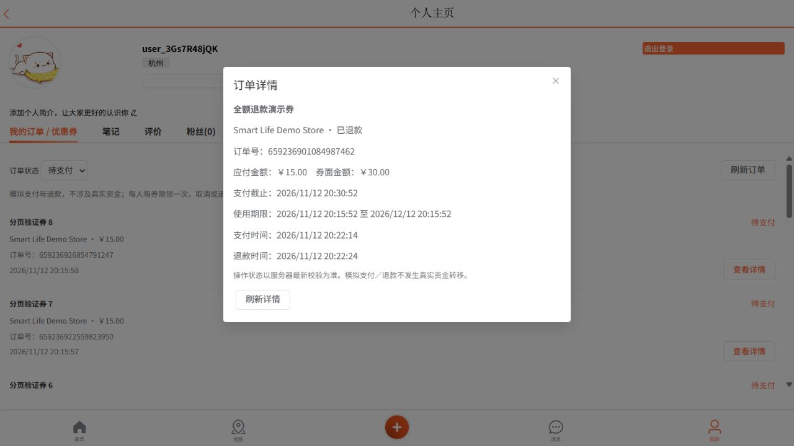
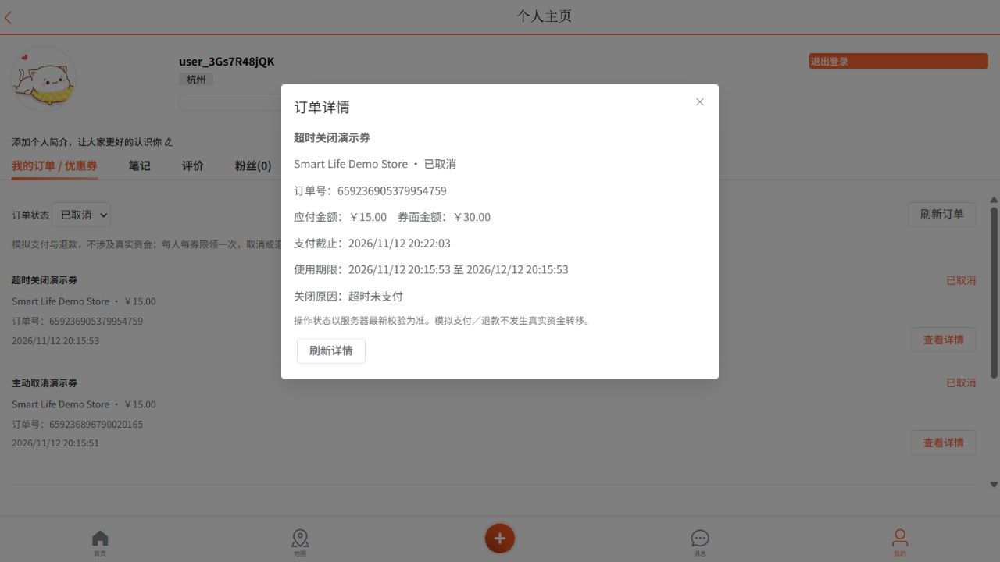
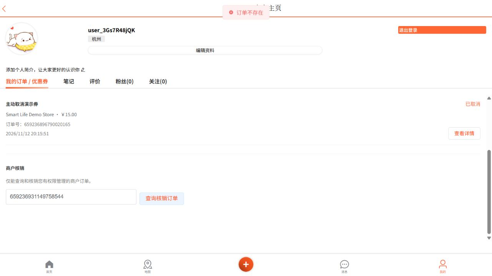
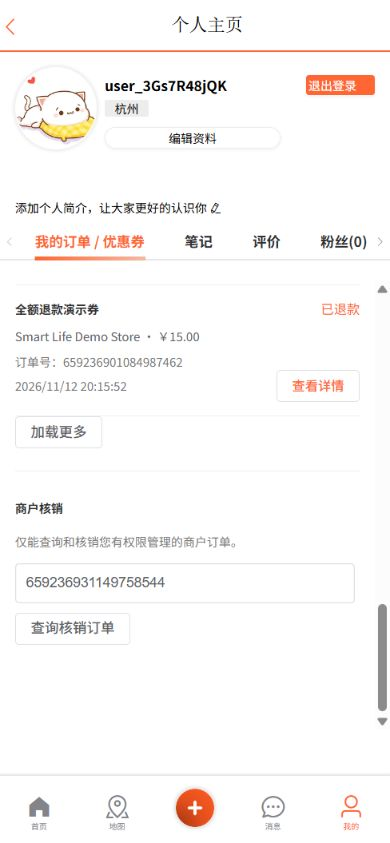
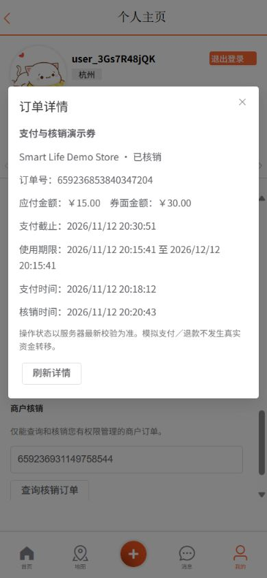

# P1 订单生命周期验证

页面及全量验证于 2026-11-12，最终审查及边界回归于 2026-11-13。业务规则、接口和旧库迁移见 [运行说明](../order-lifecycle.md)。本轮使用 JDK 21、真实 MySQL／Redis／RocketMQ，以及打包后的应用和 Nginx；只使用隔离环境的合成数据。

## 自动测试

最终完整 `clean verify`：149 项 Java 测试，0 失败、0 错误、0 跳过，构建成功。包括原有回归、21 项生命周期集成测试、缓存工作负载验证。前端实际处理函数及 Vue 模板测试 24 项通过；资源检查覆盖 19 个脚本、133 个本地引用。Nginx 配置校验通过。

```powershell
$env:SMARTLIFE_INTEGRATION_TESTS = 'true'
$env:SMARTLIFE_ORDER_RECOVERY_ENABLED = 'false'
$env:SMARTLIFE_SYNC_ENABLED = 'false'
$env:SMARTLIFE_LIFECYCLE_ENABLED = 'false'
mvn clean verify '-Dtest=P1VoucherIT,OrderConsumptionIT,OrderRequestRecoveryIT,StackUpgradeIT,OrderSafetyIT,RedisIdWorkerIT,P1BoundaryIT,ShopCacheIT,OrderLifecycleIT,CacheWorkloadIT,*Test'
npm run test:frontend
npm run check:frontend
```

连接参数与服务启动见 [本地开发](../local-development.md)。关闭调度仅用于夹具隔离，正常演示保持默认开启。

覆盖本人及跨用户查询、精确字符串 ID、稳定游标分页、快照不可变、重复动作、支付与关闭／退款与核销竞争、使用期边界、早到／重复延迟消息、真实延迟投递、Redis 返还后的确认丢失、子进程退出恢复，以及异常数据保留 REVIEW。恢复队列增加两组 400 条失败前缀的回归，确认正常后续任务仍能推进。

开发中曾遇到：缓存夹具缺必填字段；旧查询测试依赖全库只有种子数据；恢复队列固定排序使失败前缀挤占任务；个人页底部被裁切；操作成功后详情读取失败导致列表未刷新；无返还任务时误显示“处理中”。分别修正夹具隔离、按最早尝试时间公平调度、复用原页面滚动区域、刷新恢复和状态文案。未以削弱断言替代修复。

最终独立审查另发现已过使用期但支付期限未到的订单仍可支付，以及子进程固定 `java.exe` 不兼容 Ubuntu。新增回归先复现支付预期400、实际200，再同时收紧服务端支付和 `canPay`；未来使用期仍允许预付，已成功支付重放不变。子 JVM 沿用仓库既有的操作系统分支选择可执行文件；对应修复经只读复查确认。

最终隔离回归中，生命周期测试增至 21 项并全部通过。第一次重跑被仍在运行的本轮演示 JAR 调度干扰，导致崩溃窗口 PENDING 已变 DONE，以及数据库锁竞争；核验 PID 与命令后停止该演示进程，再重跑，未放宽断言。运行集成夹具时应停止连接同一测试库的演示应用。

## 实际页面验证

真实登录后在现有个人页操作，未伪造 DOM 或替换接口：

| 场景 | 页面与最终数据结果 |
| --- | --- |
| 列表、筛选、加载更多、刷新 | 12 单分两页，精确 ID，刷新后状态一致 |
| 模拟支付后商户核销 | 状态 3，SQL／Redis 库存均为 2（初始 3） |
| 主动取消 | 状态 4，两处库存均恢复 3 |
| 全额模拟退款 | 状态 6，两处库存均恢复 3 |
| 超时关闭 | 将专用样例截止时间设为过去，真实调度关闭至 4，两处库存均恢复 3 |
| 跨商户查询 | 返回“订单不存在”，不展示其他店订单 |
| 390×844 移动视口 | 列表底部、加载更多、商户输入和详情操作可达 |

四个最终样例均保留 Redis 领取资格，取消／退款／超时返还记录 DONE。超时演示通过修改专用夹具截止时间触发，没有声称实际等待默认 900 秒。












## 演示与边界

启动后从商户详情抢购，落库后点击“我的订单”，在个人页筛选待支付并打开详情：模拟支付／取消；已支付未核销且未过期的单可全额模拟退款。有显式 OWNER／ADMIN 授权的账号可在同页按订单号查询本店并核销。勿给普通用户自动加商户权限。

支付期限默认 900 秒，未传券使用期时默认当前时间至 30 天后；领取期、支付期、使用期分别校验。一人一券包含取消／退款记录。没有真实支付、部分退款或取消后重领。历史快照无依据时禁止盲目操作。

缓存测量见 [原始数据及方法](cache-workload.md)：直接调用服务、统计真实回源查询与调用耗时，不是 HTTP 容量压测；缓存读取故障注入不等于整台 Redis 断网。没有宣称改造前后提速比例或全 Broker 故障演练。
