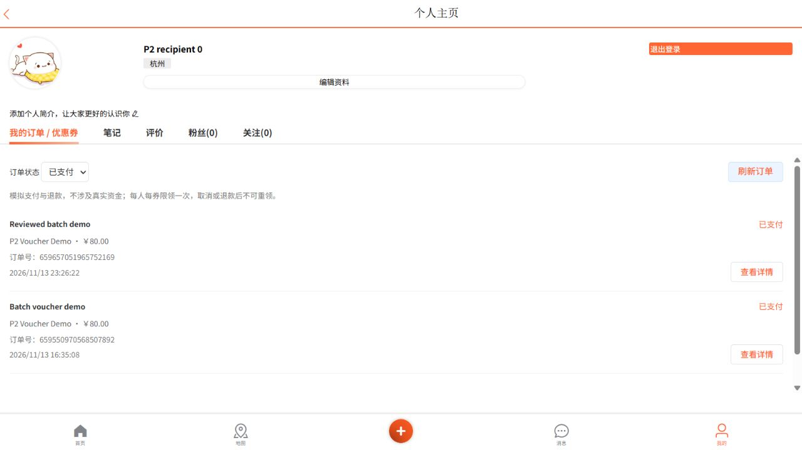

# 券列表权限查询复用

2026-11-14。按用户选择保留“购券＋核销”，本轮只优化已有列表；没有增加商品订单、满减结算、模板缓存或前端交互。

## 改动与证据

原先列表对每条有效已支付订单查询一次商户授权。同商户的多张券也重复查询。现在先从最多 50 条当前页记录中收集可核销候选商户，一次参数化查询读取相关 OWNER 及全局 ADMIN 授权，只在本次请求内复用；空候选不查询。订单快照、状态、金额、字符串 ID、游标与排序保持原约定。

实际核销仍通过原事务检查最新权限。列表按钮只是展示，不作为授权依据。详情查询仍直接检查当前授权，没有跨请求权限缓存。

新增真实数据库和 HTTP 回归：20 张有效已支付券分属两个商户。普通用户可核销 0 张、第一家店主 10 张、管理员 20 张、撤权后 0 张；每次列表均只执行 1 次权限 SQL。撤权后对原订单执行核销返回 404，订单仍为已支付。仅待支付页不执行核销权限查询。

原实现 RED：预期 1 次，实际 20 次；修正后上述完整用例 GREEN。计数限定 JdbcTemplate 有类型参数的公开查询入口，排除框架内部重载转调，不能把内部方法调用次数当 SQL 次数。初版计数器包含内部重载，开发时已纠正。此结论是 SQL 次数，不是延迟、吞吐或容量提升比例。

## 复现

按[本地开发](../local-development.md)启动独立测试依赖并配置连接，停止同库演示进程；开启 `SMARTLIFE_INTEGRATION_TESTS=true`，将四个恢复／同步／批量扫描开关关闭：

```powershell
mvn '-Dtest=OrderLifecycleIT#listLoadsGrantsOnceAndRevocationStillBlocksRedemption' test
```

完整回归命令沿用[批量发券验证](voucher-distribution.md)。不要针对业务库执行这些合成夹具。

## 最终验证

- 业务代码 `ed61f3d` 完整 `clean verify`：180 项，0 失败、0 错误、0 跳过，BUILD SUCCESS，7 分 38 秒；[计数记录](order-list-permissions-tests.json)。
- 独立审查无 Critical/Important。两处 Minor 已修正：逐条按快照商户断言权限、只清理成功插入的夹具。测试修正 `2e891d6` 后定向回归再次通过，1 项、0 失败/错误/跳过；业务代码没有进一步变化。最终提交仍须远端三项 CI 全绿。
- 前端 40 项全部通过；语法、模板和 20 段脚本／134 处资源引用检查通过。
- 新打包 JAR 经真实 Nginx、MySQL、Redis、MQ 运行。普通收券账号刷新后显示两张已支付券，已支付筛选及刷新正常、待支付筛选为空，详情保留 80/100 元及原使用期；普通用户没有商户控制区。店主登录后查询本店已支付订单，仍显示“确认核销”。撤权、跨商户和管理员的逐条权限及实际拒绝操作由上述真实 HTTP/数据库回归覆盖，不冒充浏览器里人工撤权。



本轮没有 UI/UX 布局变化，上图为后端优化后的实际页面回归证据。没有新增数据库结构或迁移要求。满减结算按用户选择暂不实施，模板缓存继续等待必要性证据，不为勾选待办增加无用缓存。
