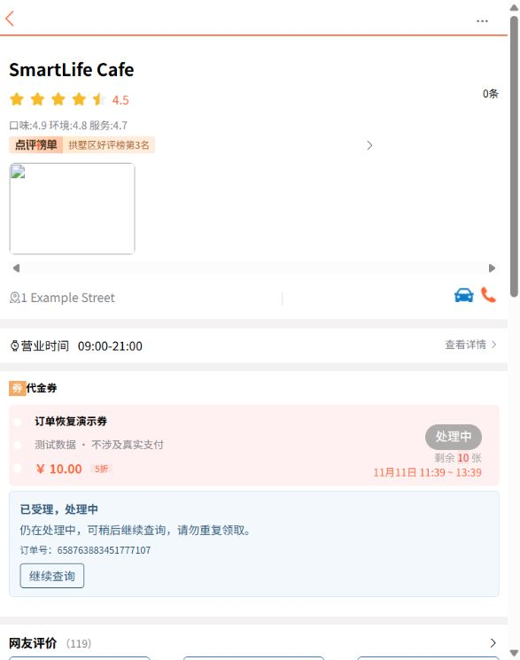
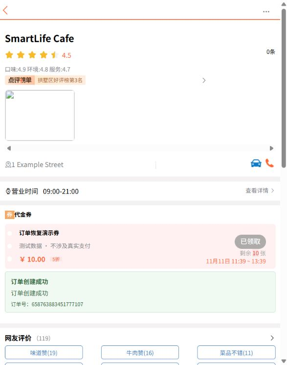
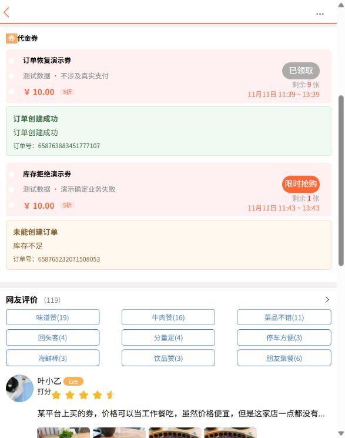

# 订单受理与恢复验证（2026-11-11）

环境：Windows、JDK21、项目既有 Maven／Vue3；隔离 Docker MySQL8.4、Redis8.4、RocketMQ5.5.0，客户端5.5.1。仅使用合成账号、券和独立MQ topic/group。

## 自动验证

```powershell
$env:SMARTLIFE_INTEGRATION_TESTS='true'
$env:SMARTLIFE_ORDER_RECOVERY_ENABLED='false'
# 连接参数按 docs/local-development.md 设置，禁止指向业务库
mvn --batch-mode --no-transfer-progress clean verify '-Dtest=OrderConsumptionIT,OrderRequestRecoveryIT,StackUpgradeIT,OrderSafetyIT,RedisIdWorkerIT,*Test'
npm run check:frontend
npm run test:frontend
```

本机结果：**83项 Java 测试通过，0失败／0跳过；11项 JS／CLI 测试通过；18脚本与130本地资源引用检查通过**。构建并启动了实际 Spring Boot JAR。

| 验证点 | 方法与结果 |
| --- | --- |
| 原消息重投／并发／提交后未ACK | 实际SQL事务与消费入口重放，最终一条订单，SQL库存仅减一次；真实Broker锁竞争后重试成功 |
| 补偿幂等 | 同订单补偿重复10次不多退；无归属、历史资格、非法库存不盲目改量；补偿完成而状态未回写可重跑 |
| HTTP重试与权限 | 相同用户/key返回原字符串ID；换券拒绝；未知和他人结果相同；未登录401 |
| 发送结果不确定 | 模拟超时与晚到消费，保留原预占，原ID重发；发送仍失败记RETRY而不是SUCCEEDED |
| 真进程退出 | 测试子JVM使用真实业务服务，分别在Redis预占后、真实MQ发送后调用Runtime.halt(73)；等待锁失效，再用原ID恢复并消费，最终库存各9、一条SQL订单。故障钩子仅在test源码，未打入生产JAR |
| 核对范围 | 正常在途WAIT不补量；遗留补偿不被新请求饿死；人工队头经审计冷却后让出批次；CLI只执行打印过的ID |
| 时区 | MySQL会话+08/-08分别验证陈旧／新鲜判定，使用数据库时钟；生产连接初始化UTC |
| 跨事务读取 | 真实MQ重复领取复现旧MyBatis缓存误报成功，独立短读事务后正确返回拒绝 |
| 前端 | 实际模块验证大ID字符串、有限轮询、刷新恢复、超时同key、继续不新建、跨登录隔离、缓存不含bearer；实际PowerShell拒绝非正OrderId |

先观察失败再修复：新增5个后端边界断言均在旧实现失败，前端／CLI4个新增断言亦失败；修正后纳入上述完整回归。一次独立审查的7项重要问题均落实回归；通用超时提示亦改为不局限订单。

## 真实页面与数据库核对

未修改DOM或伪造API。真实前端经本机代理调用18081端口JAR；关闭消费者截图处理中，启用消费者后点击继续变为成功，刷新仍恢复同一结果。另在专用券构造Redis1／SQL0，消费者确认拒绝并记录补偿done。

- 演示成功订单：658763883451777107，券367；SQL一条，SQL与Redis可用库存9。
- 演示拒绝订单：658765232071508053，券368；SQL订单0条，失败原因为REJECTED_OUT_OF_STOCK，补偿done。撤销本次预占不等于自动修复此前人为制造的库存差异。
- 实际JAR恢复CLI对已成功订单预览NONE、执行空列表、退出0，证明重跑不新建；陈旧发布及实际崩溃后的执行由上述集成测试覆盖。







## 仍保留的边界

不把提交后未ACK的“等价消息重放”描述成整个进程已被杀；真正halt实验是上面两项独立子进程测试。无压测性能承诺。任意Redis丢数据、历史归属缺失及矛盾终态需要人工核对；记录归档、支付与退款仍未实现。生产部署须按 [迁移与协调切换](../order-recovery.md) 执行。
